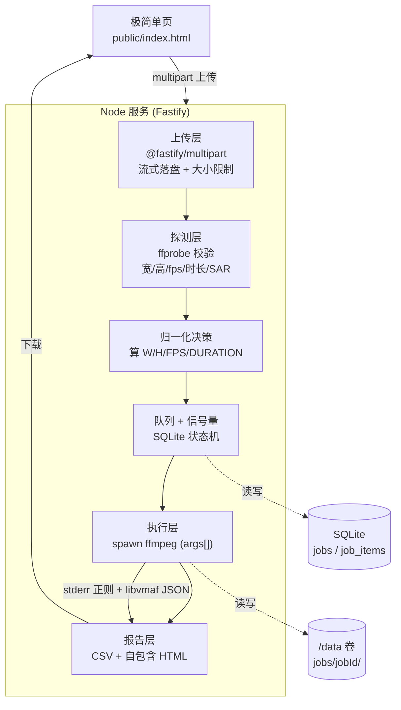
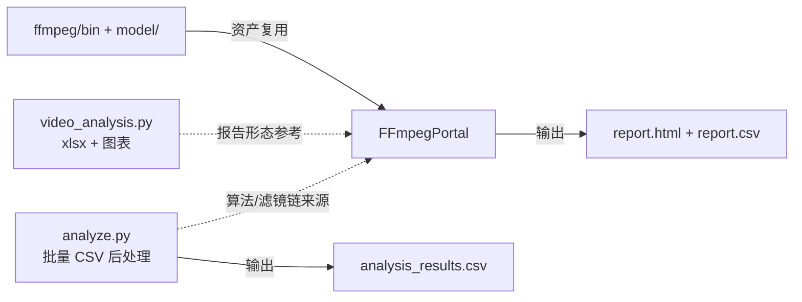

# Web 画质评分服务 —— 设计文档

> 状态：**已实现并上线（v1.0.0）**。本文记录**设计决策与 M0–M4 实施过程**，属历史+原理文档。
> 目标读者：维护者、二次开发者、评审者
> 当前使用与运维请看：[README.md](README.md)（功能与 API）、[DEPLOYMENT.md](DEPLOYMENT.md)（部署手册）
>
> 算法来源：`analyze.py`、`video_analysis.py`（位于 **python-autotest** 仓库，本服务从中演进而来，
> 并修正了它们的三个缺陷：只归一化目标片、线程数写死、失败用 `"N/A"`/`0` 兜底）

---

## 1. 目标与范围

把仓库现有的「离线脚本 + 手工跑」画质分析能力，包装成一个**可部署的单机 Web 服务**：用户上传一组视频，勾选评分指标，得到 CSV + HTML 报告。

### 1.1 在范围内（MVP）

| # | 能力 |
|---|---|
| 1 | 上传 **1 个参考视频 + N 个待测视频**，批量对比（一次 job） |
| 2 | 勾选指标：**PSNR / SSIM / VMAF**（至少选一项） |
| 3 | 服务端自动做**分辨率 / 帧率 / 时长 / 像素格式 / 旋转**归一化 |
| 4 | 生成 **HTML 报告**（自包含、可离线打开）+ **CSV 报告**（Excel 友好） |
| 5 | 极简单页：上传 → 勾选 → 进度 → 看报告/下载 |
| 6 | 单机 Docker 部署，SQLite + 文件系统持久化，重启不丢任务记录 |
| 7 | 任务队列、并发限流、超时、取消、临时文件清理 |

### 1.2 明确不在范围内（MVP 不做）

- 音频质量对比（PSNR/SSIM/VMAF 均为视频指标；现有代码 `-an` 丢音频）
- 逐帧曲线图 / 波形对比（VMAF JSON 已采集逐帧数据，**报告只展示池化值**，逐帧留给下一版）
- 多节点 / k8s / 对象存储 / Redis
- arm64 镜像（当前 ffmpeg 二进制仅 x86-64）
- 用户体系与配额（仅可选固定 Token 鉴权）
- 时间轴对齐纠偏（见 §7.4 已知局限）

---

## 2. 关键设计决策

| 决策点 | 选择 | 理由 |
|---|---|---|
| 运行时 | **Node.js 24 + Fastify** | Fastify 的 multipart（`@fastify/multipart`，底层 busboy）原生流式落盘，最适合 GB 级上传 |
| 存储 | **SQLite（`better-sqlite3`）+ 文件系统** | 单机无需外部依赖；同步 API 在 Node 里反而简单可靠 |
| 基础镜像 | **`node:24-bookworm-slim`** | 必须 glibc；**禁用 alpine**（musl 跑不了该 ffmpeg） |
| ffmpeg 来源 | **复用仓库 `ffmpeg/bin/`** | 已含 `--enable-libvmaf` 与内置 `vmaf_v0.6.1` 模型，版本已验证可出分 |
| 执行方式 | `child_process.spawn(ffmpeg, [...args])` | **参数数组**，杜绝 shell 注入；文件名是用户输入 |
| 粒度 | **一个待测视频 = 一次 ffmpeg 进程** | 参考片被解码 N 次，但 VMAF 才是成本大头，换来失败隔离与进度可见 |
| 并发 | **默认同时只跑 1 个 ffmpeg**，吃满配额核心 | 两级并行（多进程 × 多线程）互相抢占，反而更慢更不可预测 |
| 归一化 | **两路都归一化**（现有代码只处理了目标片） | 用户上传视频五花八门，VFR/fps 不一致会让 VMAF 无法对齐 |
| 报告 | **自包含 HTML（内联 CSS/SVG，无 CDN）+ CSV(utf-8-sig)** | 内网/离线可打开；不引 chromium，镜像不膨胀 |
| 鉴权 | 可选 `AUTH_TOKEN` | 内网部署默认关闭 |

---

## 3. 系统架构



### 3.1 目录结构（项目根）

```
FFmpegPortal/
├── Dockerfile              # 构建上下文 = 项目根
├── docker-compose.yml
├── package.json
├── ffmpeg/bin/             # 运行资产（不入库，setup-assets.sh 置备）
├── model/vmaf_v0.6.1.json
├── src/
│   ├── server.js           # Fastify 启动、插件注册、优雅停机
│   ├── config.js           # 环境变量解析、cgroup 探测
│   ├── routes/
│   │   ├── jobs.js
│   │   ├── references.js
│   │   └── health.js
│   ├── lib/
│   │   ├── db.js           # SQLite 连接 + 迁移
│   │   ├── upload.js       # 流式 multipart 落盘
│   │   ├── probe.js        # ffprobe 封装
│   │   ├── normalize.js    # 归一化参数决策
│   │   ├── ffmpeg.js       # 命令构造 + spawn + 解析
│   │   ├── queue.js        # 信号量 / 任务调度 / 取消
│   │   ├── report.js       # CSV + HTML 渲染
│   │   └── cleanup.js      # 过期清理
│   └── public/index.html
└── test/
```

**构建上下文即项目根**：`docker build -t ffmpeg-portal:1.0.0 .` —— `ffmpeg/bin/` 与 `model/` 就在项目内。

---

## 4. API 契约

### 4.1 约定

- 所有接口前缀 `/api`，请求/响应均 `application/json`（报告下载除外）
- 错误统一返回 `{ "error": { "code": "...", "message": "...", "details": {} } }`
- 时间字段一律 **ISO 8601 UTC**（`2026-11-24T11:00:00.000Z`）
- 长任务返回 `202 Accepted` + `jobId`，通过轮询获取进度

### 4.2 接口清单

| 方法 | 路径 | 说明 |
|---|---|---|
| `GET` | `/` | 极简单页 |
| `GET` | `/healthz` | 存活探针（进程活着即 200） |
| `GET` | `/readyz` | 就绪探针（ffmpeg/ffprobe/模型自检通过） |
| `POST` | `/api/references` | 上传并登记参考视频（可复用） |
| `GET` | `/api/references` | 参考视频列表 |
| `DELETE` | `/api/references/:id` | 删除参考视频 |
| `POST` | `/api/jobs` | 创建批量对比任务 |
| `GET` | `/api/jobs` | 任务列表（分页） |
| `GET` | `/api/jobs/:id` | 任务详情 + 每个待测项结果 |
| `POST` | `/api/jobs/:id/cancel` | 取消任务 |
| `DELETE` | `/api/jobs/:id` | 删除任务及产物 |
| `GET` | `/api/jobs/:id/report.csv` | 下载 CSV |
| `GET` | `/api/jobs/:id/report.html` | 查看 HTML 报告 |
| `GET` | `/api/jobs/:id/result.json` | 机器可读结果 |

### 4.3 `POST /api/references`

`multipart/form-data`，字段：

| 字段 | 类型 | 必填 | 说明 |
|---|---|---|---|
| `file` | file | 是 | 参考视频 |

**201**

```json
{
  "referenceId": "ref_2f8c1a",
  "probe": {
    "width": 1920, "height": 1080, "fps": 30, "durationS": 79.18,
    "videoCodec": "h264", "pixFmt": "yuv420p", "sar": "1:1", "rotation": 0
  },
  "sizeBytes": 94652112,
  "createdAt": "2026-11-24T11:00:00.000Z"
}
```

### 4.4 `POST /api/jobs`

`multipart/form-data`，字段：

| 字段 | 类型 | 必填 | 说明 |
|---|---|---|---|
| `referenceId` | string | 二选一 | 复用已上传的参考视频 |
| `reference` | file | 二选一 | 随任务上传参考视频 |
| `targets` | file（可多个） | 是 | 待测视频，1..N 个 |
| `metrics` | string | 否 | 逗号分隔，默认 `psnr,ssim,vmaf`；合法值 `psnr,ssim,vmaf` |
| `fpsOverride` | number | 否 | 强制归一化帧率（默认自动：取两路较小值） |
| `maxDurationS` | number | 否 | 只比较前 N 秒（默认：取两路公共时长） |
| `normalize` | bool | 否 | 默认 `true` |

**202**

```json
{
  "jobId": "job_9a3b7d",
  "status": "queued",
  "metrics": ["psnr", "ssim", "vmaf"],
  "items": [
    { "itemId": "itm_01", "seq": 1, "name": "QV_1785521903261.mp4", "status": "queued" },
    { "itemId": "itm_02", "seq": 2, "name": "QV_1785522013852.mp4", "status": "queued" }
  ],
  "createdAt": "2026-11-24T11:00:05.000Z"
}
```

### 4.5 `GET /api/jobs/:id`

```json
{
  "jobId": "job_9a3b7d",
  "status": "running",
  "metrics": ["psnr", "ssim", "vmaf"],
  "progress": { "done": 1, "failed": 0, "total": 3 },
  "reference": { "referenceId": "ref_2f8c1a", "probe": { "width": 1920, "height": 1080, "fps": 30, "durationS": 79.18 } },
  "normalization": { "width": 1920, "height": 1080, "fps": 30, "durationS": 74.5, "pixFmt": "yuv420p" },
  "items": [
    {
      "itemId": "itm_01", "seq": 1, "name": "QV_1785521903261.mp4",
      "status": "done",
      "probe": { "width": 854, "height": 480, "fps": 30, "durationS": 79.18 },
      "compared": { "frames": 2235, "seconds": 74.5 },
      "metrics": {
        "psnr": { "mean": 20.859065, "min": 18.2 },
        "ssim": { "mean": 0.75543 },
        "vmaf": { "mean": 10.540322, "min": 2.1, "harmonicMean": 8.9 }
      },
      "elapsedMs": 27400
    },
    { "itemId": "itm_02", "seq": 2, "name": "QV_1785522013852.mp4", "status": "running" }
  ]
}
```

任务状态机：`queued → running → done | failed | canceled`
单项状态机：`queued → probing → running → done | failed | skipped`

### 4.6 轮询 vs SSE

MVP 用**轮询**（`GET /api/jobs/:id`，前端 1s 一次）。SSE（`GET /api/jobs/:id/events`）列为可选增强，Fastify 侧成本很低，若前端体验需要再加。

---

## 5. 数据模型（SQLite）

```sql
PRAGMA journal_mode = WAL;
PRAGMA foreign_keys = ON;

CREATE TABLE IF NOT EXISTS references (
  id           TEXT PRIMARY KEY,          -- ref_xxxxxx
  orig_name    TEXT NOT NULL,
  stored_path  TEXT NOT NULL,             -- /data/refs/<id>/source.<ext>
  size_bytes   INTEGER NOT NULL,
  sha256       TEXT NOT NULL,
  probe_json   TEXT NOT NULL,             -- ffprobe 精简结果
  width        INTEGER,
  height       INTEGER,
  fps          REAL,
  duration_s   REAL,
  created_at   TEXT NOT NULL,
  last_used_at TEXT
);
CREATE INDEX IF NOT EXISTS idx_ref_sha ON references(sha256);

CREATE TABLE IF NOT EXISTS jobs (
  id             TEXT PRIMARY KEY,        -- job_xxxxxx
  status         TEXT NOT NULL,           -- queued|running|done|failed|canceled
  metrics        TEXT NOT NULL,           -- "psnr,ssim,vmaf"
  reference_id   TEXT REFERENCES references(id) ON DELETE SET NULL,
  normalization  TEXT,                    -- JSON: W/H/fps/duration/pixFmt
  ffmpeg_threads INTEGER,
  error          TEXT,
  created_at     TEXT NOT NULL,
  started_at     TEXT,
  finished_at    TEXT
);
CREATE INDEX IF NOT EXISTS idx_jobs_status ON jobs(status, created_at);

CREATE TABLE IF NOT EXISTS job_items (
  id                TEXT PRIMARY KEY,     -- itm_xx
  job_id            TEXT NOT NULL REFERENCES jobs(id) ON DELETE CASCADE,
  seq               INTEGER NOT NULL,
  orig_name         TEXT NOT NULL,
  stored_path       TEXT NOT NULL,
  size_bytes        INTEGER NOT NULL,
  status            TEXT NOT NULL,        -- queued|probing|running|done|failed|skipped
  probe_json        TEXT,
  compared_frames   INTEGER,
  compared_seconds  REAL,
  psnr              REAL,
  psnr_min          REAL,
  ssim              REAL,
  vmaf              REAL,
  vmaf_min          REAL,
  vmaf_harmonic     REAL,
  elapsed_ms        INTEGER,
  ffmpeg_cmd        TEXT,                 -- 便于复现/排障
  log_path          TEXT,                 -- /data/jobs/<id>/logs/<item>.log
  error             TEXT,
  started_at        TEXT,
  finished_at       TEXT
);
CREATE INDEX IF NOT EXISTS idx_items_job ON job_items(job_id, seq);
```

> 迁移策略：启动时执行上述 `CREATE TABLE IF NOT EXISTS` + `PRAGMA user_version` 版本号，不做逆向迁移（单机部署可接受）。

---

## 6. 存储布局

```
/data/
├── db.sqlite  (+ -wal, -shm)
├── refs/<referenceId>/source.<ext>
└── jobs/<jobId>/
    ├── inputs/<itemId>.<ext>       # 待测原文件
    ├── logs/<itemId>.log           # ffmpeg stderr（限 64KB 头部+尾部）
    ├── logs/<itemId>.vmaf.json     # libvmaf 逐帧 JSON
    ├── report.html
    └── report.csv
```

生命周期：

| 数据 | 保留策略 |
|---|---|
| 待测原文件 | job 完成 + 报告生成后**默认删除**（`KEEP_INPUTS=false`） |
| 参考视频 | 保留，供复用（`DELETE /api/references/:id` 手动删） |
| 日志 | 保留到 job 删除；单文件截断上限 256KB |
| job 目录 | `RETENTION_DAYS`（默认 7）后台定时清理 |
| 孤儿文件 | 启动时扫描 `/data/jobs/*` 与 DB 比对，清理无 DB 记录的目录 |

---

## 7. 评分管线（核心）

### 7.1 归一化决策

参考视频探测定基准，**两路都做相同归一化**（这是对现有代码的关键修正——`analyze.py` 只缩放目标片）：

```
W, H   = 参考宽高，向下取偶数（yuv420p 要求偶数，奇数会直接报错）
FPS    = fpsOverride ?? min(fps_ref, fps_tgt)      ← 取小，避免插帧/丢帧更糟
DUR    = maxDurationS ?? min(duration_ref, duration_tgt)
PIXFMT = yuv420p
SAR    = 1:1
ROTATE = 依赖 ffmpeg 默认 autorotate（竖拍视频自动摆正）
```

每个滤镜链统一为：

```
scale=W:H:flags=bicubic, setsar=1, fps=FPS, format=yuv420p,
setpts=PTS-STARTPTS, trim=duration=DUR
```

> 说明：`setpts=PTS-STARTPTS` 让两路都从 0 开始；`trim` 保证帧数一致（否则一侧提前结束，PSNR/SSIM 会被截断且无告警）。

### 7.2 ffmpeg 命令模板

单条 `filter_complex` 一次跑完所有勾选指标（复用同一次解码，实测比多进程快 6–7 倍）：

```bash
ffmpeg -hide_banner -nostdin -y \
  -i <target> \
  -i <reference> \
  -filter_complex "
    [0:v]scale=W:H:flags=bicubic,setsar=1,fps=FPS,format=yuv420p,setpts=PTS-STARTPTS,trim=duration=DUR[dist];
    [1:v]scale=W:H:flags=bicubic,setsar=1,fps=FPS,format=yuv420p,setpts=PTS-STARTPTS,trim=duration=DUR[ref];
    [dist]split=3[d1][d2][d3];
    [ref]split=3[r1][r2][r3];
    [d1][r1]psnr;
    [d2][r2]ssim;
    [d3][r3]libvmaf=model='path=MODEL:version=vmaf_v0.6.1':log_path=JSON:log_fmt=json:n_threads=N
  " \
  -f null -
```

构造规则：

- `split=N` / `[dN][rN]` 的 N **等于勾选的指标数**；未勾选的指标对应分支整段省略
- 只勾 PSNR/SSIM 时不加 JSON 日志（快很多）
- `-nostdin` 防止 ffmpeg 吞掉父进程 stdin
- **绝不用 shell 字符串拼接**：全部走 `spawn(bin, argsArray)`

### 7.3 结果解析

| 指标 | 来源 | 提取方式 |
|---|---|---|
| PSNR | stderr | `psnr.*?average:([\d.]+)` 与 `min:([\d.]+)` |
| SSIM | stderr | `ssim.*?All:([\d.]+)`（括号内是 dB，不用） |
| VMAF | libvmaf JSON | `pooled_metrics.vmaf.{mean,min,harmonic_mean}` |
| 比较帧数/秒 | ffmpeg 进度 `frame=` 最后一行 或 `compared_frames = round(DUR × FPS)` | 写入 `compared_frames` |

**失败必须显式化**：`analyze.py` 写 `"N/A"` 字符串、`video_analysis.py` 返回 `0`——后者与「画质极差」无法区分。本服务要求：解析失败 → item 置 `failed` 并记录原因，**不得用 0 兜底**。

### 7.4 已知局限（必须在报告页脚声明）

> 1. PSNR/SSIM/VMAF 都要求**逐帧空间对应**。本服务对齐了分辨率、帧率、时长与起始点，但**不做内容级时间轴纠偏**。若待测视频相对参考片存在片头偏移、变速、剪切，分数会显著失真且不可信。
> 2. 帧率取两路较小值：若待测片帧率更低，参考片会被抽帧（信息损失），反之待测片会被插帧（伪影）。
> 3. VMAF 为空间域指标，不反映音频质量、卡顿、色彩偏移的主观感受。
> 4. 报告只展示池化值（均值/最差帧/谐波均值），不展示逐帧曲线。

---

## 8. 并发、资源与线程模型

### 8.1 CPU 配额探测

```js
// 优先 cgroup v2，其次 v1，最后 os.availableParallelism()
// 容器内实际路径：/sys/fs/cgroup/cpu.max  →  "400000 100000" = 4 核
//                  "max 100000"           →  不限
```

`FFMPEG_THREADS` 默认 = `floor(cpuQuota / CONCURRENCY)`，并 clamp 到 `[1, 16]`。

> 这一点直接修掉 `analyze.py` 把 `n_threads=12` 写死的问题：2 核容器开 12 线程会因过度订阅反而更慢。

### 8.2 并发模型

```
CONCURRENCY (默认 1)  ——  同时运行几个 ffmpeg 进程
队列            ——  内存 FIFO + SQLite 状态，进程重启后按 status 恢复
取消            ——  kill(-pid, SIGTERM) → 5s 后 SIGKILL，标记 canceled
超时            ——  TIMEOUT_MS 默认 = max(120s, 3 × 预估耗时)，超时杀进程组
排除项          ——  单个 item 失败不影响同 job 其他 item（skipped/failed 隔离）
```

**为什么默认 1**：VMAF 已是多线程 CPU 密集任务，再叠多进程并行会让各进程互相偷核心，总吞吐不增反降，且内存峰值不可控。需要吞吐时更有效的是**多容器副本 + 共享队列**（不在 MVP）。

### 8.3 优雅停机

收到 `SIGTERM`：停止接受新请求 → 标记 running 的 job 为 `interrupted` → kill 在跑的 ffmpeg 进程组 → 关闭 SQLite → 退出。`docker stop` 默认 10s 宽限，配 `stop_grace_period: 20s`。

---

## 9. 错误码

| HTTP | code | 触发条件 |
|---|---|---|
| 400 | `INVALID_MULTIPART` | 表单结构非法 / 缺字段 |
| 400 | `NO_TARGETS` | 未提供任何待测视频 |
| 400 | `INVALID_METRICS` | 指标不在 `psnr,ssim,vmaf` 子集内，或为空 |
| 400 | `INVALID_PARAM` | `fpsOverride`/`maxDurationS` 非正数 |
| 401 | `UNAUTHORIZED` | 启用了 `AUTH_TOKEN` 但未带/带错 |
| 404 | `JOB_NOT_FOUND` / `REFERENCE_NOT_FOUND` | id 不存在 |
| 404 | `REPORT_NOT_READY` | job 未完成即请求报告 |
| 409 | `JOB_ALREADY_FINISHED` | 对已结束任务取消 |
| 413 | `FILE_TOO_LARGE` | 单文件超 `MAX_FILE_MB`（默认 2048） |
| 413 | `JOB_TOO_LARGE` | 任务总量超 `MAX_JOB_MB`（默认 5120） |
| 415 | `UNSUPPORTED_MEDIA` | ffprobe 未找到视频流（纯音频/损坏） |
| 422 | `PROBE_FAILED` | ffprobe 解析失败或时长/分辨率异常 |
| 422 | `NO_COMMON_OVERLAP` | 两路无公共可比时长（DUR ≤ 0） |
| 429 | `QUEUE_FULL` | 排队任务超 `MAX_QUEUE`（默认 20） |
| 500 | `FFMPEG_FAILED` | ffmpeg 非零退出，`details.stderrTail` 截断 4KB |
| 500 | `PARSE_FAILED` | ffmpeg 成功但指标解析不出来 |
| 503 | `NOT_READY` | 启动自检未通过（找不到 ffmpeg/ffprobe/模型） |

---

## 10. 报告规格

### 10.1 CSV

- 编码 **utf-8-sig**（仓库既有约定，保证 Excel 中文不乱码）
- 文件名 `report.csv`

列：

```
item_seq, file_name, status, size_mb, width, height, fps, duration_s,
compared_seconds, compared_frames, psnr, ssim, vmaf, vmaf_min, elapsed_ms, error
```

### 10.2 HTML

- **单文件自包含**：内联 `<style>`，图表用内联 SVG / CSS 条形，**不引 CDN**（内网离线可用）
- 组成：
  1. 标题区：job id、创建/完成时间、参考片信息、归一化参数
  2. 汇总表：每行一个待测视频，指标列带**色阶**（PSNR/VMAF 高绿低红）
  3. 横向条形图：VMAF（或所选首要指标）对比
  4. 页脚：**§7.4 已知局限声明** + ffmpeg 版本 + 生成时间
- 转义：文件名必须 HTML 转义（用户输入）

---

## 11. Docker 打包

### 11.1 `Dockerfile`

```dockerfile
# ---------- 依赖层 ----------
FROM node:24-bookworm-slim AS deps
WORKDIR /app
COPY package.json package-lock.json ./
RUN npm ci --omit=dev --no-audit --no-fund && npm cache clean --force

# ---------- 运行层 ----------
FROM node:24-bookworm-slim

ENV NODE_ENV=production \
    HOME=/tmp

WORKDIR /app

COPY --chown=node:node --from=deps /app/node_modules ./node_modules
COPY --chown=node:node package.json ./

# ffmpeg 资产：注意 ffmpeg/ 被 .gitignore 忽略，构建前必须确保文件存在（见 11.4）
# 必须用 COPY --chown，不要写成 COPY + 后续 chown -R /app
COPY --chown=node:node ffmpeg/bin/ffmpeg  ffmpeg/bin/ffprobe /app/bin/
COPY --chown=node:node model/vmaf_v0.6.1.json /app/model/vmaf_v0.6.1.json

COPY --chown=node:node src ./src
COPY --chown=node:node scripts ./scripts

# 二进制在构建上下文里已是 0755，无需 chmod
RUN mkdir -p /data/refs /data/jobs \
 && chown -R node:node /data

USER node

ENV FFMPEG_PATH=/app/bin/ffmpeg \
    FFPROBE_PATH=/app/bin/ffprobe \
    VMAF_MODEL=/app/model/vmaf_v0.6.1.json \
    DATA_DIR=/data \
    PORT=3000

EXPOSE 3000

HEALTHCHECK --interval=30s --timeout=5s --start-period=20s --retries=3 \
  CMD node -e "fetch('http://127.0.0.1:3000/readyz').then(r=>process.exit(r.ok?0:1)).catch(()=>process.exit(1))"

CMD ["node", "src/server.js"]
```

> 不装任何 apt 包：`node:24-bookworm-slim` 已含 glibc 2.36（二进制只需 2.28）与 `libgcc_s.so.1`（唯一额外动态依赖）。
> 不带 `ffplay`（省约 200MB）。
> ⚠️ **层数陷阱**：若先 `COPY` 400MB 二进制再 `RUN chmod/chown -R`，会再生成一个 429MB 的完整副本层 —— 实测镜像从 1.49GB 降到 **912MB** 靠的就是改用 `COPY --chown`。

### 11.2 `.dockerignore`（项目根）

```
.git
.github
.vscode
tmp
data
test_results
*.log
node_modules
npm-debug.log*
*.md
!README.md
```

⚠️ **不可忽略 `ffmpeg/bin/` 与 `model/`** —— 它们不入 git 仓库，但必须是构建上下文的一部分
（`ffmpeg/bin/` 由 `scripts/setup-assets.sh` 置备）。

> 早期版本在 python-autotest 仓库内构建，需排除该仓库的 Python 部分（`.venv`、`appuimUnitTest`、
> `original_video`、`*.apk`、含明文凭据的 `requere.txt` 等）。独立成项目后已不再需要这些规则。

### 11.3 `docker-compose.yml`（仓库根）

```yaml
services:
  quality-web:
    build:
      context: .
      dockerfile: Dockerfile
    image: ffmpeg-portal:1.0.0
    ports:
      - "3000:3000"
    volumes:
      - quality-data:/data
    environment:
      MAX_FILE_MB: "2048"
      MAX_JOB_MB: "5120"
      CONCURRENCY: "1"
      RETENTION_DAYS: "7"
      KEEP_INPUTS: "false"
      # AUTH_TOKEN: "change-me"
    cpus: 4.0
    mem_limit: 4g
    shm_size: 1gb
    read_only: true
    tmpfs:
      - /tmp:size=2g
    stop_grace_period: 20s
    restart: unless-stopped

volumes:
  quality-data:
```

### 11.4 构建前置坑（必须写进 README）

| 坑 | 事实 | 应对 |
|---|---|---|
| `ffmpeg/bin/` 被 `.gitignore` 忽略 | 二进制各约 168MB，超出仓库单文件限制 | `scripts/setup-assets.sh` 从 FFmpeg-Builds（GitHub）下载并校验 libvmaf；无外网时 `--offline` 从本地复制 |
| `model/` **未被 git 跟踪**（也未忽略） | `git ls-files model/` 为空 | **建议把 `model/vmaf_v0.6.1.json`（19KB）纳入版本管理**，否则干净克隆后构建失败 |
| 二进制仅 x86-64 | `file` 确认 ELF x86-64 | 构建机与运行机同为 x86-64；arm 需另找 ffmpeg 源 |
| GPL 版 ffmpeg | 配置含 `--enable-gpl` | 内部部署无碍；对外分发镜像需合规评估 |

---

## 12. 容量与性能预算（本机实测）

测试环境：32 核 x86-64，`ffmpeg N-122953`，素材取自 python-autotest 仓库的 `original_video/` 真实样片。

| 场景 | 指标组合 | n_threads | 实测 |
|---|---|---|---|
| 4s @ 852×480 | psnr+ssim+vmaf | 12 | 0.20 s |
| 8s @ 720p→480p | psnr+ssim+vmaf | 12 | 0.72 s |
| **10s @ 1080p** | psnr+ssim+vmaf | **4** | **3.53 s** |

**折算（4 线程，1080p 全指标）**

- ≈ **0.35× 实时**：1 分钟素材约需 21 秒
- ≈ **每小时可处理 170 分钟素材**
- 单条 79 秒 1080p 视频 ≈ **28 秒**

按 `--cpus 4` 部署、单 worker 串行估算：**每 28 秒出一个待测视频结果**，10 条一批约 5 分钟。

内存：VMAF 1080p 单进程典型 0.5–1.5 GB（含解码缓冲），`mem_limit: 4g` 留有余量；`shm_size` 给足以防长片缓冲。

---

## 13. 安全与合规

| 面 | 措施 |
|---|---|
| 命令注入 | `spawn(bin, args[])`，**永不拼 shell 字符串**；文件名只进 DB 与报告（转义后展示），落盘路径用 id |
| 路径穿越 | 上传文件名 `path.basename()` + 白名单字符集；实际路径 100% 由服务端 id 生成 |
| 资源耗尽 | 单文件/任务大小上限、`MAX_QUEUE`、超时、并发=1、`mem_limit`/`cpus` |
| 权限 | 容器内 `USER node`、`read_only: true`、仅 `/data` 与 `/tmp` 可写 |
| 恶意媒体 | 仅 ffprobe 校验；ffmpeg 解析漏洞风险靠「不联网 + 非 root + 只读根」缓解；可选加 `-t` 时长硬上限（防解压炸弹式超长文件） |
| 凭据泄漏 | 本服务**不含任何凭据**。早期在 python-autotest 内构建时，须排除该仓库的 `Script_Qihoo*.py`、`requere.txt`（含明文账号密码）等；独立成项目后构建上下文已只含本服务代码 |
| XSS | HTML 报告所有用户输入做 HTML 转义 |
| 鉴权 | 可选 `AUTH_TOKEN`（Bearer）；内网默认关闭 |

---

## 14. 里程碑与验收标准

| 里程碑 | 内容 | 验收标准 | 状态 |
|---|---|---|---|
| **M0** | Dockerfile + compose + `/readyz` 自检 | 容器内 `ffmpeg -filters` 有 `psnr/ssim/libvmaf`；用仓库素材跑通三指标**真的出分** | ✅ 完成（镜像 912MB，容器内与宿主结果逐位一致） |
| **M1** | ffprobe 探测 + 归一化 + 单文件评分 | 用 1080p 参考 + 480p 待测，产出与 `analyze.py` 一致 | ✅ 完成（算法与 `analyze.py` 同源，见 §15） |
| **M2** | REST API（references / jobs / 报告下载）+ 队列 | `curl` 走通「传参考 → 建 job → 轮询 → 下 CSV/HTML」全链路 | ✅ 完成（35 项断言，宿主机与容器均通过） |
| **M3** | 极简单页 | 浏览器完成上传→勾选→看报告；进度可见 | ✅ 完成（Chrome CDP 驱动 13 项断言） |
| **M4** | 健壮性 | 取消/超时/超大文件/非法格式/并发提交均返回正确错误码，不泄漏进程与临时文件 | ✅ 完成（17 项断言，覆盖 5 种配置实例） |

**回归对照**：M1 必须与 `analyze.py` 对同一组素材交叉验证。注意 `analyze.py` 只归一化目标片，本服务归一化两路 —— 对「两路分辨率相同」的素材应完全一致；对「两路分辨率不同」的素材允许有差异，但需记录在测试用例说明里。

---

## 15. M0 预验证结果（已实测，2026-11-24）

在正式实现前，已在容器内验证了本设计最大的两个技术风险，**均通过**。

### 15.1 二进制依赖假设（验证「无需任何 apt 包」）

用本机已有的 glibc 镜像（`mongo:7.0`，Ubuntu glibc **2.35**）挂载 `ffmpeg/bin` 直接运行：

| 检查项 | 结果 |
|---|---|
| 动态依赖解析 | `ldd /ff/ffmpeg` → **7 项全部解析成功** |
| glibc 版本 | 容器 2.35 ≥ 二进制所需 **2.28** ✅ |
| `libgcc_s.so.1` | 容器内**已存在** ✅（唯一额外依赖，无需 apt） |

结论：`node:24-bookworm-slim`（glibc 2.36）同样满足，**Dockerfile 不需要任何 `apt-get install`**。

### 15.2 容器内 VMAF 出分（验证「滤镜可用」）

素材：1080p 参考片 6s（1920×1080 / h264 / crf16）vs 480p 待测（854×480 / crf32），按 §7.2 模板在容器内执行：

```
VMAF score: 39.945063
SSIM All:0.805281
PSNR average:25.757786 (min:24.973988)
```

- 三指标**在容器内全部正常出分** ✅
- 进度 `frame=173 / speed=2.88x`（4 线程）✅ —— 证明 `-f null -` 下 stderr 的 frame 计数可用于进度统计
- 期间两路均施加 `scale/setsar/fps/format/setpts` 归一化，无报错 ✅

### 15.3 顺带发现的实现约束

1. **同一路流不能直接复用两次**：`[d][r]psnr;[d][r]ssim` 会失败，**必须 `split=N`**。§7.2 模板已含，实现时勿简化掉。
2. `/tmp` 在部分环境（含本机沙箱）会被清理 → **临时文件一律落在 `DATA_DIR`（`/data`）下的 job 目录**，不要用系统 `/tmp`。这也与 §11.3 的 `read_only` + `tmpfs /tmp` 配置一致。

---

## 16. M0 实施记录（已完成，2026-11-24）

### 16.1 交付物

| 文件 | 说明 |
|---|---|
| `package.json` / `package-lock.json` | 依赖：fastify 5.12.8、@fastify/multipart 10.1.9、@fastify/static 10.1.12 |
| `src/config.js` | 环境变量解析 + **cgroup CPU 配额探测** |
| `src/server.js` | Fastify 启动、统一错误响应、优雅停机 |
| `src/routes/health.js` | `/healthz` `/readyz` `/api/config` |
| `src/lib/runner.js` | 子进程封装（超时、进程组终止、头尾截断缓冲） |
| `src/lib/ffprobe.js` | 探测宽高/fps/时长/SAR/旋转 |
| `src/lib/normalize.js` | 归一化参数决策 |
| `src/lib/ffmpeg.js` | 滤镜链构造 / 执行 / 三指标解析 |
| `src/lib/selfcheck.js` | ffmpeg、滤波器、模型、数据目录自检 |
| `src/lib/errors.js` | 错误码 → HTTP 状态码映射 |
| `scripts/selftest.js` | **M0 验收脚本**：合成素材 → 端到端评分 → 断言 |
| `src/public/index.html` | 状态页（M3 会扩成上传表单） |
| `Dockerfile`、`.dockerignore`、`docker-compose.yml` | 打包 |

### 16.2 验收结果

| 验收项 | 结果 |
|---|---|
| 宿主机 `node scripts/selftest.js` | ✅ PSNR 29.808674 / SSIM 0.923312 / VMAF 64.165984 / harmonic 64.133694 |
| **容器内** `docker run --rm <image> node scripts/selftest.js` | ✅ **与宿主机逐位一致**（同素材同参数） |
| 只读根 + 非 root + `--cpus 4` 下启动 | ✅ `/readyz` = `ready` |
| cgroup 配额探测 | ✅ 32 核宿主限 4 核 → 容器内检测到 `cpuCores:4, ffmpegThreads:4` |
| 无数据卷时 | ✅ `/readyz` 正确返回 503 并指出 `data:writable: EROFS` |
| 镜像体积 | **912MB**（已从 1.49GB 优化，见 §11.1 层数陷阱） |

### 16.3 与本文档原设计的偏差

| # | 原设计 | 实际 | 原因 |
|---|---|---|---|
| 1 | `better-sqlite3` | **`node:sqlite`（Node 24 内置）** | 免掉原生编译依赖，镜像无需 gcc/python；已验证 Node 24.22 下无需 flag 可用 |
| 2 | `model='path=..:version=vmaf_v0.6.1'` | **`model=path=<file>` 单键** | 本 build 的 `libvmaf` 把 `model` 定义为单字符串选项，双键写法报 `Option not found`（已实测 5 种写法） |
| 3 | 镜像 550–700MB | **912MB** | 基础镜像解包 333MB + ffmpeg/ffprobe 402MB + node_modules 27MB |

### 16.4 实施中踩到并已修复的坑

1. **`HeadTailBuffer` 重复拼接**：小输出时 head 与 tail 各存一份，`toString()` 拼起来导致 ffprobe 的 JSON 前缀重复 → 解析失败。修复后 `head + tail` 不重叠。
2. **`chmod`/`chown -R` 制造 429MB 重复层** → 改用 `COPY --chown=node:node`。
3. **Docker Hub 在本机完全不可达**（daemon 与宿主 curl 均超时），改用 `docker.m.daocloud.io/library/node:24-bookworm-slim` 拉取后 `docker tag` 成本地 `node:24-bookworm-slim`。**CI/他机构建时需注意此点**。
4. **npm 缓存目录只读**：`~/.npm` 在沙箱外不可写 → `npm install --cache ../tmp/npm-cache`。
5. **`/tmp` 被系统清理** → 测试与运行时临时文件一律落在 `DATA_DIR` 下。
6. **默认资产路径依赖 `process.cwd()`**：早期从子目录 `npm start` 时找不到 `ffmpeg/bin`（容器里因用绝对路径 env 而掩盖）。已改为**相对项目根**解析（`src/..`），宿主机与容器行为一致。

---

## 17. M2 实施记录（已完成，2026-11-24）

### 17.1 新增交付物

| 文件 | 说明 |
|---|---|
| `src/lib/db.js` | SQLite 数据层（`node:sqlite`），含轻量列迁移与崩溃恢复 |
| `src/lib/upload.js` | 流式落盘、单文件大小限制、sha256、文件名消毒 |
| `src/lib/report.js` | CSV（BOM）/ 自包含 HTML / result.json |
| `src/lib/queue.js` | 队列调度、信号量、取消、超时、报告收尾 |
| `src/routes/references.js` | `/api/references` 增删查 + 内容去重复用 |
| `src/routes/jobs.js` | `/api/jobs` 创建/查询/取消/删除/报告下载 |
| `scripts/smoke-api.sh` | **M2 验收脚本**：35 项断言，覆盖 8 个错误码 |

### 17.2 验收结果（宿主机与容器内各跑一遍，均 35/35 通过）

| 类别 | 覆盖点 |
|---|---|
| 健康 | `/healthz` 200、`/readyz` 200 |
| 参考视频 | 首次上传 201、相同内容复用 200+`reuse=true`、列表、删除 |
| 错误码 | `JOB_NOT_FOUND` 404、`NO_TARGETS` 400、`INVALID_METRICS` 400、`REFERENCE_NOT_FOUND` 404、非视频 422、错误字段名 400、`JOB_ALREADY_FINISHED` 409 |
| 批量评分 | 2 个待测全指标完成；**VMAF 方向正确**（劣化片低于良好片） |
| 报告 | CSV 200 且带 `EF BB BF` BOM；HTML 自包含（5.3KB，无任何外部资源）；result.json `status=done` |
| 指标子集 | 只选 `psnr,ssim` 时不产出 `vmaf` 字段 |
| 取消 | 观测到 running 后取消 → `canceled`；重复取消 409 |
| 删除 | 204，删除后查询 404 |
| **重启持久化** | 重启容器后任务与参考视频全部保留 |
| **崩溃恢复** | 任务运行中 `docker kill -9` → 重启后自动重排并**成功完成**（40s 1080p，4 核 15s） |

### 17.3 修掉的缺陷

| # | 问题 | 说明 |
|---|---|---|
| 1 | `insertItems` 取 `it.id` 而调用方传 `itemId` | 导致建任务报「cannot be bound to SQLite parameter 1」；已修正映射并加防御性校验 |
| 2 | 报告在状态落库前生成 | `result.json` 残留 `status: running`；改为先落最终状态再生成报告 |
| 3 | 验收超时用例设计错误 | 参考片仅 6s 而待测 30s，公共可比时长被正确截断为 6s → 任务过快无法取消。**这是设计正确行为**，改用 40s 长参考 + 运行态轮询 |

### 17.4 实现要点（与设计的对应）

- **归一化时长 = min(参考, 待测)**：这一条在验收中直接体现了价值——30s 待测 vs 6s 参考只比较前 6s，报告里 `compared.seconds=6` 明确写出「比了多少」。
- **并发=1**：`concurrency` 语义是「同时处理几个任务」；单任务内 item 顺序执行，避免两级并行抢核。
- **取消**：通过 `runProcess` 的 `onChild` 回调拿到进程组句柄，SIGTERM → 5s 后 SIGKILL。

---

## 18. M3 + M4 实施记录（已完成，2026-11-24）

### 18.1 新增交付物

| 文件 | 说明 |
|---|---|
| `src/public/index.html` | 极简单页：复用/上传参考、多选待测、勾选指标、高级选项、实时进度、结果表、报告链接 |
| `src/lib/cleanup.js` | 保留期清理 + 孤儿目录清扫（设计 §6 承诺，此前缺失） |
| `scripts/smoke-ui.mjs` | **M3 验收**：Chrome DevTools Protocol 驱动真实浏览器 |
| `scripts/smoke-robust.mjs` | **M4 验收**：以 5 种配置启动实例，验证边界行为 |

### 18.2 M3 验收（浏览器级，13/13）

用 Chrome CDP 真实操作页面（非模拟）：设文件输入 → `requestSubmit()` → 轮询 DOM → 校验报告链接可下载。

| 检查项 | 结果 |
|---|---|
| 页面加载、`/readyz` 渲染为「就绪」、ffmpeg 版本显示 | ✅ |
| 参考下拉从 API 填充（含分辨率/帧率/时长） | ✅ |
| 文件选择后提示更新、表单提交 | ✅ |
| 进度卡片出现、观测到「评分中」、最终「已完成」 | ✅ |
| 结果表渲染出数值、报告链接可访问（HTML/CSV） | ✅ |
| 容器内同一套件复跑 | ✅ 13/13 |

视觉验证：首页与报告页均已截图确认（色阶、min/hm 子行、条形图、局限声明齐全）。

### 18.3 M4 验收（17/17，5 种配置实例）

| 场景 | 配置 | 验证点 |
|---|---|---|
| 并发提交 | `CONCURRENCY=1` | 两个任务同时提交均 202，最终都 done（排队不互相破坏） |
| 取消清理 | 同上 | 取消长任务后**扫描 `/proc` 确认无 ffmpeg 残留** |
| 超大文件 | `MAX_FILE_MB=1` | 1.7MB 文件 → **413 `FILE_TOO_LARGE`** |
| 队列上限 | `MAX_QUEUE=1` | 第 2 个任务 → **429 `QUEUE_FULL`** |
| 超时 | `TIMEOUT_MS=1000` | item 标记失败且错误含 `[TIMEOUT]` |
| 鉴权 | `AUTH_TOKEN=...` | 无/错 Token → 401；正确 → 200；`/healthz` `/readyz` 免鉴权 |
| 未就绪 | `FFMPEG_PATH=/nonexistent` | `/readyz` → `not_ready`；建任务 → **503 `NOT_READY`** |
| 磁盘卫生 | 默认 | 无 ffmpeg 临时文件；报告齐全；`KEEP_INPUTS=false` 时 inputs 已删 |

### 18.4 本阶段修掉的缺陷

| # | 问题 | 影响 | 修法 |
|---|---|---|---|
| 1 | `AppError` 默认 `status=500` 且优先于状态码表 | 超大文件返回 **500 而非 413**，错误码被埋 | 构造函数改为 `status ?? STATUS_BY_CODE[code] ?? 500` |
| 2 | 取消时正在跑的 item 被记成 `failed` | 报告里出现「失败」而非「已取消」 | catch 中判任务是否 canceled，是则标 `skipped` |
| 3 | M4 脚本用 `pgrep -af ffmpeg` 探测泄漏 | 把执行脚本的 shell 自身算进去 → **假阳性** | 改为扫 `/proc/<pid>/cmdline` 精确匹配 |
| 4 | 设计承诺的保留期/孤儿清理未实现 | 磁盘只增不减 | 新增 `cleanup.js`，启动即扫 + 小时级周期 |

### 18.5 完整回归结果

| 套件 | 宿主机 | 容器内（read-only + 非 root + 4 核） |
|---|---|---|
| `smoke-api.sh`（35 项） | ✅ 35/35 | ✅ 35/35 |
| `smoke-ui.mjs`（13 项） | ✅ 13/13 | ✅ 13/13 |
| `smoke-robust.mjs`（17 项） | ✅ 17/17 | —（配置矩阵类测试，在宿主跑） |
| `selftest.js`（环境+三指标） | ✅ | ✅ |

---

## 19. 上线后变更（M4 之后）

以下改动发生在 §18 记录之后，为**部署实测暴露的问题**，均已修复并回归验证。

| # | 问题 | 影响 | 修法 |
|---|---|---|---|
| 1 | **优雅停机（SIGTERM）会把运行中的 item 判为失败** | `docker stop` / 滚动升级时，在跑的任务被判 `failed` 且 `inputs/` 被删，重启后**无法恢复** | 停机导致的中断把 item 退回 `queued`、任务退回 `queued` 并**保留 inputs**；`#finalize` 增加保护：仍有未完成项则不收尾、不删 inputs |
| 2 | 停机日志被 `process.exit()` 截断 | 看不到 `[停机]` 分步耗时，无法判断卡在哪 | 退出前 `await logger.flush()`；并给停机流程加分步计时日志 |
| 3 | `/data` 不可写时报 SQLite 堆栈 | 部署最常见配置错误难以自查 | 启动预检，输出可操作中文提示并以 `exit 1` 退出 |
| 4 | 本地 `npm start` 默认 `DATA_DIR=/data` | 无权限创建，开箱不可用 | 默认改为项目内 `./data`；容器仍由 `ENV DATA_DIR=/data` 覆盖 |
| 5 | `selftest` 不创建 `DATA_DIR` | 首次运行误报「环境不可用」 | 脚本内先 `ensureDataDirs()` |
| 6 | ffmpeg 二进制超出仓库单文件限制（GitHub 100MB） | 无法推送到 GitHub | `.gitignore` 排除 `ffmpeg/bin/`；`scripts/setup-assets.sh` 改为**从 FFmpeg-Builds（GitHub）下载**并强制校验 libvmaf，另支持 `--offline` 本地复制与固定版本+sha256 |
| 7 | 原始 ffbuild 自建二进制无公开下载来源 | 新机器无法置备资产 | 改用 FFmpeg-Builds 的 `n8.1` linux64 GPL 静态构建（含 libvmaf）。实测 PSNR/SSIM **逐位一致**，VMAF 差 **+0.000182**；镜像由 912MB 降至 **855MB** |

### 19.1 修复后实测的停机与恢复语义

| 场景 | 实测耗时 | 行为 |
|---|---|---|
| 空闲停机 | ≈ 0.2 s | 关 HTTP → 停队列 → 关库 → 退出 |
| 任务运行中停机 | ≈ 1.2 s | 额外杀 ffmpeg、item 退回排队、保留 inputs |
| 重启（优雅停机后） | 自动 | 任务续跑并**成功完成**（60 s 1080p，VMAF 90.76） |
| 重启（`kill -9` 后） | 自动 | 同上，`recoverInterrupted()` 把「进行中」回退为「排队」 |

> 续跑是**整个视频重算**，ffmpeg 不续传中间进度。

### 19.2 当前吞吐实测（4 核容器，1080p）

| 指标组合 | 折合速度 |
|---|---|
| PSNR + SSIM + VMAF | **2.4× 实时** |
| 仅 PSNR + SSIM | **9.8× 实时** |

VMAF 占总耗时约 75–80%。详见 [DEPLOYMENT.md](DEPLOYMENT.md) §6。

---

## 20. 早期待定项（已全部决策）

下列问题在设计阶段待定，实施时已按「建议默认值」落地，现记录于此备查。实际运行时配置以
[DEPLOYMENT.md](DEPLOYMENT.md) §5 为准。

| # | 问题 | 建议默认值 |
|---|---|---|
| 1 | 待测原文件是否保留 | 报告生成后删除（`KEEP_INPUTS=false`） |
| 2 | 参考视频是否允许复用 | 允许（`/api/references`） |
| 3 | 是否要 SSE 实时进度 | MVP 轮询，SSE 留增强 |
| 4 | 是否需要固定 Token 鉴权 | 内网默认关闭 |
| 5 | 报告是否需要 Excel | MVP 不做（CSV 已够 Excel 打开） |
| 6 | 是否采集逐帧 VMAF 曲线 | 采集并落盘（JSON 已生成），但 MVP 报告不展示 |
| 7 | 部署机核数（决定 `cpus` 与 `FFMPEG_THREADS`） | 待确认 |

---

## 附：与现有脚本的关系



**不修改** `analyze.py` / `video_analysis.py`：它们是本仓库既有交付物，且 `video_analysis.py` 的 `__main__` 硬编码了另一个项目的路径（见 AGENTS.md 陷阱 6）。本服务是**独立的并行实现**，算法口径以 `analyze.py` 为准，并修正其已知缺陷（只归一化目标片、线程数写死、`"N/A"` 兜底）。
